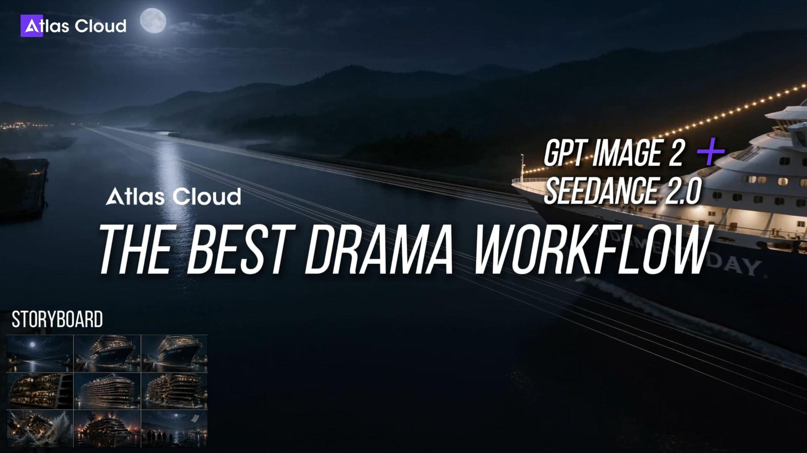

# The Ultimate Drama Workflow Skill: GPT Image 2 + Seedance 2.0 Unified with One API Key



> One 9-panel storyboard + one 15-second animated video = one episode of comic drama.
> One Atlas Cloud API key, two API calls, end-to-end pipeline.

---

## 1. Where It Started: Two Models Collide

April 2026.

OpenAI shipped **GPT Image 2 (beta)** — text rendering, world knowledge, and aesthetic all pushed to the limit.

> "From today onward, AI-generated images, just like AI-generated text, have officially entered an era where ordinary people can no longer tell them apart from the real thing."

At the same time, two high-traction posts surfaced on X:

**[@AI_Jasonyu](https://x.com/AI_Jasonyu/status/2046573987002499418):**

> GPT-Image 2 (beta) + Seedance 2.0 — put these two together and it's a killer combo.
> The workflow is simple: GPT-Image 2 produces the storyboard first; once confirmed, hand it to Seedance 2.0 to run the long-form video.
> **This is how AI video should work.**

**[@arrakis_ai](https://x.com/arrakis_ai/status/2046821264535556143):**

> The Codex + GPT Image 2 pipeline is completely broken. This is the single most disruptive AI workflow I've seen this year.
> I dropped a manuscript in with one line — "convert this into a comic book" — and out came **a fully formed comic book**.

Both posts pointing at the same thing: **the best image model + the best video model, chained into one pipeline**.

The problem: to run that pipeline before, you needed OpenAI GPT Image 2 quota, ByteDance Seedance 2.0 access, and custom glue code for both ends' prompts, polling, and CDN handling.

Not anymore.

---

## 2. Atlas Cloud Now Has GPT Image 2: One Key, Both Ends Wired

[Atlas Cloud](https://atlascloud.ai) just added **GPT Image 2** to its model roster, sitting in the same pool as the full **Seedance 2.0 lineup** (Text-to-Video / Image-to-Video / Reference-to-Video / Fast / Upscaled).

| Before | Now |
|--------|-----|
| Apply for OpenAI quota + integrate Seedance separately | **One Atlas Cloud API key** |
| Two SDKs, two billing systems, two sets of docs | Unified endpoint: `https://api.atlascloud.ai/api/v1` |
| Roll your own polling / CDN / error handling | Official SDK / MCP / Skill templates ready |

There are really only two endpoints:

```bash
# Generate images (GPT Image 2 / Seedream / Qwen Image ...)
POST https://api.atlascloud.ai/api/v1/model/generateImage
# Generate videos (Seedance 2.0 / Kling / Vidu ...)
POST https://api.atlascloud.ai/api/v1/model/generateVideo
# Shared polling endpoint
GET  https://api.atlascloud.ai/api/v1/model/prediction/{id}
```

Bearer token auth. `export ATLASCLOUD_API_KEY=...` and you're ready.

> **Compliance note**: Every character in this tutorial is rendered as a **photorealistic digital character** by GPT Image 2. No real-person likeness is implied or involved.

---

## 3. Best Image Model **GPT Image 2** + Best Video Model **Seedance 2.0**

Most AI video tutorials out there pick one of two approaches:

**Approach A: Pure text-to-video** (direct prompt → 15s video)
- Problem: single-shot gambling, burn compute every retry.

**Approach B: Multi-shot segments** (6–12 shots × 5s each, stitched together)
- Problem: slow (6× image gen + 6× video gen), expensive, character consistency easily breaks.

`drama-director` takes a **third route**:

**Approach C: One 9-panel comic page + one 15-second animated video**
1. GPT Image 2 generates **a single 3×3 nine-panel page** (9 storyboard frames drawn into one image, like a comic book page).
2. Seedance 2.0 I2V consumes that page + a motion prompt and **produces one 15s video in a single call** — Seedance treats the 9-panel image as its **visual DNA and storyboard reference** (characters, wardrobe, locations, lighting, color palette all locked from the image) and outputs a **15-second cinematic shot of the actual scene** — you literally see nanofilaments stretched taut, a cruise ship sailing in, metal slabs shearing, water columns erupting — not "the camera panning across a comic book."

**The three advantages of this combo:**

| Dimension | 9-panel route | 6-8 shot segmented route |
|-----------|--------------|-------------------------|
| **Cost** | 1 image gen + 1 video gen | 6-8× image gens + 6-8× video gens |
| **Time** | ~3-5 min | ~8-15 min |
| **Character consistency** | All 9 panels on **one canvas** — model guarantees it naturally | Each shot generated independently, needs reference-to-video to anchor |
| **Iteration cost** | Tweak image_prompt, regenerate one image | One panel change ripples through the whole pipeline |
| **Deliverable** | One complete comic-drama video, ready to post | Requires post-production stitching |

Point 3 — **character consistency** — is the biggest pain point in chained workflows. A 9-panel grid is literally "9 regions on the same canvas," so GPT Image 2 naturally keeps the same character looking the same, wearing the same outfit, across all 9 panels. That single design decision eliminates a huge amount of downstream engineering.

---

## 4. drama-director: One Message, Full Pipeline

### What You Do

Inside Claude Code, you only need:

```
Turn this novel passage into a comic drama:
<paste a passage>
```

Claude picks up the triggers ("comic drama" / "storyboard" / "九宫格" / ...), loads the `drama-director` skill, and:

1. Reads the material → distills it to 9 key beats (3×3 reading order)
2. Builds a complete `image_prompt` (panel descriptions + style constraints) and shows it to you for **review**
3. **Single call** to GPT Image 2 → 9-panel comic page (`.json` with `image_url`)
4. Shows you the 9-panel image; once you approve, **single call** to Seedance 2.0 I2V → 15-second animated comic (`.json` with `video_url`)
5. Emits a Markdown report

You only typed **two messages** start to finish: the script, and "confirm."

### Models Behind It

| Stage | Model ID (default) | Notes |
|-------|-------------------|-------|
| 9-panel page | `openai/gpt-image-2/text-to-image` | Falls back to `openai/gpt-image-1.5/text-to-image` if GPT Image 2 isn't yet public |
| Animated video | `bytedance/seedance-2.0/image-to-video` | 15s / 720p / 1:1, configurable |
| Fast variant | `bytedance/seedance-2.0-fast/image-to-video` | Cheaper, faster |

---

## 5. Install in 3 Minutes

### Step 1 — Get an API Key

Register at [atlascloud.ai](https://atlascloud.ai) and generate a key from the API Keys page.

```bash
export ATLASCLOUD_API_KEY="sk-your-key"
echo 'export ATLASCLOUD_API_KEY="sk-your-key"' >> ~/.zshrc
```

### Step 2 — Install the drama-director skill

Clone from GitHub into Claude's skills directory:

```bash
mkdir -p ~/.claude/skills
git clone https://github.com/kianaliang-dev/drama-director-skill ~/.claude/skills/drama-director
```

Verify:

```bash
ls ~/.claude/skills/drama-director/
# Expected: SKILL.md  scripts/
```

> The skill is fully self-contained — `SKILL.md` has the Scene Archetype Router (Impact / Duel / Pursuit / Journey / Atmosphere / Reveal / Confrontation etc.), Seedance engine hard constraints, and double-contrast cut rules all built in. No other skills required.

### Step 3 — Smoke-test the scripts

```bash
python3 ~/.claude/skills/drama-director/scripts/generate_image.py \
  --prompt "a cinematic 3x3 comic book page with 9 panels showing a cyberpunk chase scene, bold black gutters, film noir palette" \
  --aspect 1:1
```

After ~30 seconds you should see a JSON blob with `image_url`. Open the URL in a browser — if you see a 9-panel comic page, the whole pipeline works.

---

## 6. Demo: Operation Guzheng from *The Three-Body Problem* → 15s Comic Drama

### Why This Scene

One of the **most visually explosive** sequences in Liu Cixin's novel — a cruise ship sliced by nanofilaments on the Panama Canal. Extremely dense cinematic action, exactly 9 beats worth of material:

> Panama Canal, night. 50 nanofilaments, each less than one-tenth the diameter of a human hair, are stretched taut across the water like the strings of a giant guzheng (Chinese zither).
>
> The cruise ship *Judgment Day* approaches. The bow makes contact with the filament array. The ship continues forward — and is sliced into 45 horizontal layers.
>
> The slices shift, misalign, and collapse in sequence. Huge sheets of metal topple into the canal like playing cards, sending up water columns several stories high.
>
> Everyone on shore holds their breath. This is the first time in human history such a method has been used to annihilate every soul aboard a massive ship.

### How the Conversation Goes

**You paste into Claude Code:**

```
Turn this Three-Body Problem passage into a comic drama (9-panel grid + 15s video):

Panama Canal, night. 50 nanofilaments stretched across the water...
(full passage pasted)
```

**What Claude does:**

1. Detects triggers ("comic drama" / "9-panel grid"), loads `drama-director` skill.
2. Breaks the passage into 9 beats (filaments rigged → ship approaches → first contact → layers begin to shift → full slicing → tilting collapse → metal crashing → wide-shot aftermath → shore observers).
3. Shows you the full image_prompt for review:

```
A cinematic 3x3 comic book page with 9 panels depicting
"Operation Guzheng" from Three-Body Problem: nanofilaments
slicing a cruise ship on the Panama Canal at night.

Read order: left-to-right, top-to-bottom.

Panel 1 (top-left): 50 ultra-thin nanofilaments stretched taut across
the dark Panama Canal at midnight, invisible to the naked eye, faint
moonlight catches their threads like guqin strings.

Panel 2 (top-center): the massive cruise ship "Judgment Day" approaches,
lights ablaze, unaware. Black water, bow cutting foam.

Panel 3 (top-right): first contact — the bow touches the nanofilament array,
showing no visible resistance, ship continues forward.

Panel 4 (middle-left): interior cross-section cutaway, passengers
mid-motion, the upper floors beginning to slide a fraction of a meter
forward relative to the lower floors.

Panel 5 (middle-center, HERO SHOT): the entire ship now visibly sliced
into 45 horizontal layers, each layer displacing slightly, still holding
its shape, caught mid-collapse.

Panel 6 (middle-right): layers start tilting, catastrophic geometric
chaos, photorealistic metal fracture lines, debris beginning to fall.

Panel 7 (bottom-left): massive metal slabs crashing into the canal,
water explosions hundreds of feet high, sparks, reflections.

Panel 8 (bottom-center): wide shot, the ship now a collapsing stack
of metal pancakes, night lit by emergency flares.

Panel 9 (bottom-right): silent aftermath — shore observers (silhouettes)
stand frozen, debris field floating on black water, cold moonlight,
a single piece of paper drifting down.

Style: photorealistic cinematic, Netflix production quality, IMAX-grade
detail, dramatic but well-exposed lighting — moonlight on water, ship
running lights, emergency flares casting warm highlights. Rich color
grading (cool blues in water, warm ambers in ship lights), not overly
dark, every panel clearly legible. Bold black panel borders with thin
white gutters, consistent ship and canal appearance across all panels.
Photorealistic digital character silhouettes on shore.
16:9 aspect ratio, 8K ultra-high resolution, hyperrealistic detail.
```

**You reply "confirm."**

4. `generate_image.py` runs → 9-panel page returns in ~1 minute. Claude sends you the `image_url`.
5. You say "OK, continue."
6. Following its built-in **Scene Archetype Router**, Claude picks **Impact** (a single decisive moment = filaments slicing the ship), layers on Seedance engine hard constraints (no joint biomechanics, no reflections, double-contrast cuts) + the three-section structure (Style & Mood → Dynamic → Static), and writes a motion_prompt **describing real-world scene action** — the 9-panel image here is only visual DNA, not the subject being filmed:

```
Style & Mood: Photorealistic cinematic realism, Netflix production
quality, IMAX-grade detail. Midnight palette — cold blues in canal
water, warm amber highlights from ship running lights and emergency
flares. Dramatic but well-exposed lighting, moonlight rim on water
surface, high dynamic range retaining shadow detail. Anamorphic lens
flare on lights. 16:9, 8K hyperrealistic textures.

Dynamic Description: Opens extreme wide aerial drone shot — the Panama
Canal at midnight, 50 near-invisible nanofilaments stretched taut
across the water, catching faint moonlight like a guqin's strings, the
cruise ship Judgment Day advancing from frame right, lights blazing.
Hard cut to wide static low-angle at the waterline — the bow touches
the filament array, no visible resistance, the ship continues forward
into frame. Hard cut to medium close-up handheld on the ship's mid-hull
— HERO SHOT — the hull now visibly sliced into 45 horizontal layers,
each layer displaced a few dozen centimeters, still holding the ship's
silhouette mid-collapse. Extreme close-up insert, locked-off — one
filament stretched taut catches a pinpoint of moonlight, a thin line of
emergency flare light strobing beside it. Hard cut to wide stabilized
tracking alongside the hull — the 45 layers begin tilting and sliding,
metal slabs shearing free, sparks arcing where severed conduits short,
warm amber light spilling from the gaps. Hard cut to extreme wide crane
pull-back — massive metal slabs crashing into the canal like fallen
playing cards, water columns erupting several stories high, sparks
trailing, emergency flares lighting the mist in warm ambers against
cold blue water. Final hard cut to medium shot on the shore — a row of
silhouetted figures stands motionless, a single torn scrap of paper
drifts down from the debris column, catching a soft backlight, floating
toward the still-black water at the frame edge.

Static Description: Panama Canal at midnight, concrete canal walls,
still black water, low mist. Cruise ship Judgment Day — white
superstructure, multi-story, windows fully lit. Nanofilament array
strung between two shore anchors, invisible except for occasional
moonlight glints. Emergency flares casting warm pools along canal
banks. Shore observers as silhouetted photorealistic digital character
figures, backlit.
```

> **Key concept to get right**: Seedance I2V treats the 9-panel image as **visual DNA** (character appearance, wardrobe, location, lighting, color all locked from the image), then generates a **real-world cinematic shot** based on the motion_prompt — not "panning over a comic book." So the motion_prompt must describe what actually happens in the scene, following Seedance's preferred structure: Style & Mood → Dynamic Description (shot-by-shot) → Static Description.

7. 2-3 minutes later the video is ready. `video_url` and `/tmp/drama_output/report.md` delivered.

### Cost Estimate

| Item | Calls | Approx. price |
|------|-------|--------------|
| GPT Image 2 9-panel page (1:1, 1024×1024) | 1 | Per Atlas Cloud console current pricing |
| Seedance 2.0 I2V (15s / 720p / 1:1) | 1 | From ~$0.101/sec × 15s ≈ $1.5 |
| **Total** | | **~$1.5-2 per episode** |

Compared to single-shot T2V gambling or 6-8 shot segmented pipelines, cost drops to **1/5 – 1/8**.

---

## 7. Common Variants

| Need | Just add |
|------|---------|
| Switch to anime style | "Use Japanese anime style, Studio Ghibli palette" |
| American superhero comic feel | "Use American superhero comic style" |
| Cinematic / Netflix look | "Use photorealistic cinematic Netflix style, 16:9, 8K" |
| Vertical for TikTok/Reels | "Use 9:16 nine-panel layout" |
| 1080p output | "Render video at 1080p" |
| Save money | "Use seedance-2.0-fast" |
| Anchor lead character with real photo | "Main character looks like this: [image URL], reference this look in the 9-panel" |
| 12 panels instead of 9 | "Use a 4×3 twelve-panel grid" (works, but I2V 15s split into 12 beats feels rushed) |

---

## 8. Atlas Cloud Official MCP + Skill Repos (For Builders)

If you want to **wire your own pipeline** or call atomic tools from Claude Desktop / other agents, Atlas Cloud maintains open-source resources:

### Official Skill Repo

```bash
npx skills add AtlasCloudAI/atlas-cloud-skills
```

Repo: https://github.com/AtlasCloudAI/atlas-cloud-skills

The `references/image-gen.md` and `references/video-gen.md` are directly copy-pasteable Python / Node.js / cURL templates — our `drama-director` skill's `generate_image.py` / `generate_video.py` are built on the same call spec.

### Official MCP Server (9 tools)

```bash
claude mcp add atlascloud -- npx -y atlascloud-mcp
```

npm: https://www.npmjs.com/package/atlascloud-mcp

Once installed, these 9 MCP tools become available in Claude Desktop / Claude Code:

| Tool | Purpose |
|------|---------|
| `atlas_list_models` | List all available models (filter by `display_console: true`) |
| `atlas_search_docs` | Fuzzy-search models by keyword |
| `atlas_get_model_info` | Fetch model spec and pricing |
| `atlas_generate_image` | Submit image generation |
| `atlas_generate_video` | Submit video generation |
| `atlas_quick_generate` | Keyword → one-shot generation (auto model search) |
| `atlas_chat` | OpenAI-compatible LLM chat |
| `atlas_get_prediction` | Poll / fetch result URL |
| `atlas_upload_media` | Upload local file → public URL |

### Which Path Should You Pick?

| Your intent | Recommended path |
|-------------|-----------------|
| Turn a script into a comic drama video | **drama-director skill** (this tutorial) |
| Build your own pipeline or agent | **Official MCP** |
| Need code templates for custom apps | **Official skill repo** |
| All of the above | Install all three — they don't conflict |

---

## 9. Design Decisions Behind the Workflow

**1. Why 9 panels instead of 6 or 12?**
3×3 balances readability and information density — readers parse it at a glance, and 9 beats are enough for a full dramatic arc (setup / rising / turn / resolution × 2). 12 panels make each cell too small; 4 panels can't carry a story.

**2. Why is one image + one video enough?**
The previous table covers cost, time, and consistency. The deeper reason: Seedance 2.0 I2V is now good enough that given a 9-panel grid, it automatically produces camera motion and localized animation — tasks that previously required human video editing are now delegated to the generative model.

**3. Why does motion_prompt describe "scene action" instead of "panning the comic page"?**
We first tried writing motion_prompt as "camera sweeping across the comic page" — and Seedance faithfully generated "camera aimed at an actual comic book." Not what we wanted. The correct mental model: the 9-panel image is **visual DNA + storyboard reference** (character, wardrobe, location, lighting, color all locked from the image), and motion_prompt describes the **scene's actual action** (filaments stretching, ship slicing, metal collapsing, water exploding). Seedance "unwinds" the 9-panel image into a real cinematic shot. That's why `drama-director` bundles the full Seedance prompt specification inline in the skill — the **Archetype Router** (9 modes: Impact / Duel / Pursuit / Journey / Atmosphere / Reveal / Confrontation / Interrogation / Negotiation), **engine hard constraints** (no joint mechanics, no reflections, no exit+reentry), **double-contrast cuts** (shot size + camera mode both change), **Style & Mood / Dynamic / Static three-section structure** — one self-contained rule set, installed in a single skill.

**4. Why does the skill ban age words?**
Unified functional descriptors — "figure / character / photorealistic digital character" — are compliance-friendly and produce more stable GPT Image 2 outputs. Age words tend to trigger the model's conservative mode.

**5. Why default 1:1 instead of 16:9?**
A 9-panel grid is inherently a 3×3 square structure. 1:1 makes every panel a clean square. 16:9 stretches each panel into a tall ribbon — bad for comic storyboards. Use 9:16 when you need vertical output.

---

## 10. FAQ

**Q: How much does the API cost?**
A: Atlas Cloud is pay-as-you-go, no subscription. A 15s episode runs ~$1.5-2. Final pricing per the Atlas Cloud console.

**Q: GPT Image 2 isn't in the models list yet?**
A: `generate_image.py` falls back automatically — if it can't find `gpt-image-2`, it uses `gpt-image-1.5`. No interruption. When Atlas Cloud finishes integration, it switches over automatically.

**Q: The 9-panel image came out as one big image?**
A: Strengthen the prompt — "bold black borders between panels, clear white gutters, 3x3 comic book page layout, panels clearly separated."

**Q: Character looks different across panels?**
A: Add "same character across all panels, same outfit, same hairstyle," or prepend a character sheet description at the top of the prompt.

**Q: Video looks like a still image?**
A: The motion_prompt isn't strong enough — add "camera dolly-in, diagonal sweep, panels come alive sequentially, subtle parallax, wind, smoke, water motion."

**Q: How long does one episode take?**
A: ~1 min for the image + ~2-3 min for the video = **3-5 min to finished video**. In a hurry? Use `seedance-2.0-fast`.

**Q: Video link expired?**
A: Atlas Cloud CDN has a 24-hour TTL by default. Download to local quickly.

**Q: Does it support Chinese scripts?**
A: Yes. Claude automatically rewrites Chinese scripts into English image_prompt and motion_prompt (both models prefer English). The report keeps the original Chinese plot description.

**Q: Can I use outputs commercially?**
A: API call results are commercially usable per Atlas Cloud's terms of service. You're responsible for avoiding third-party IP infringement.

---

## 11. Where to Go Next

After installing the skill, try these prompts:

- **Classic sci-fi set pieces**: besides Operation Guzheng, try "Droplet vs. the fleet", "Dark Forest strike", "Two-dimensional foil"
- **Peak chapters from web novels**: any fantasy / thriller novel's fight or climax scene
- **News event visualization**: break a breaking news story into a 9-panel comic drama for social posts
- **Product story ads**: split product features into 9 beats, produce a 15s comic-style Story Ad
- **Historical moments**: battles, political coups, invention moments — all make great 9-panel dramas

Want to extend the skill (add TTS voiceover, burned-in subtitles, B-roll, multi-episode chains)? Just edit `~/.claude/skills/drama-director/SKILL.md` and `scripts/`. It's pure Markdown + Python — easier to modify than you'd think.

---

**Related Links**

- Atlas Cloud Console: https://atlascloud.ai
- Official Skill Repo: https://github.com/AtlasCloudAI/atlas-cloud-skills
- Official MCP Server: https://www.npmjs.com/package/atlascloud-mcp
- This tutorial's drama-director skill: `https://github.com/kianaliang-dev/drama-director-skill`